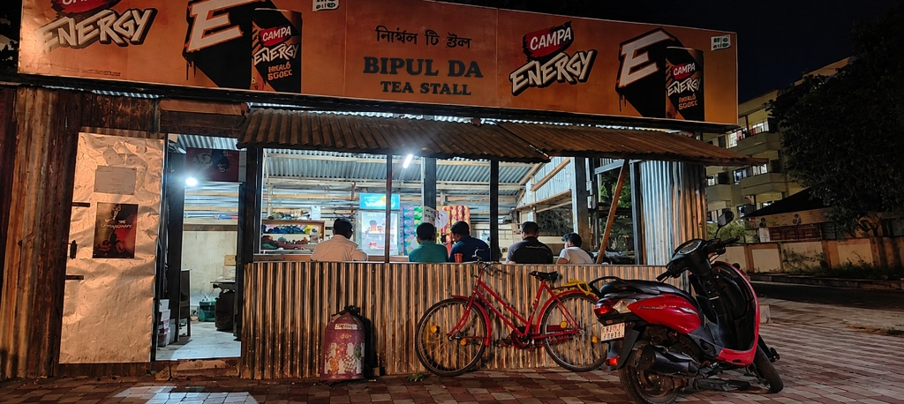
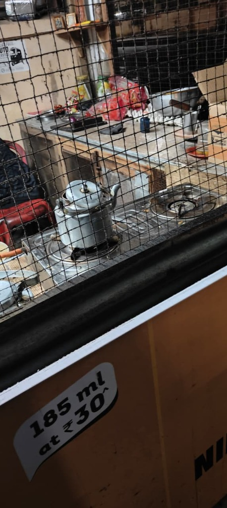
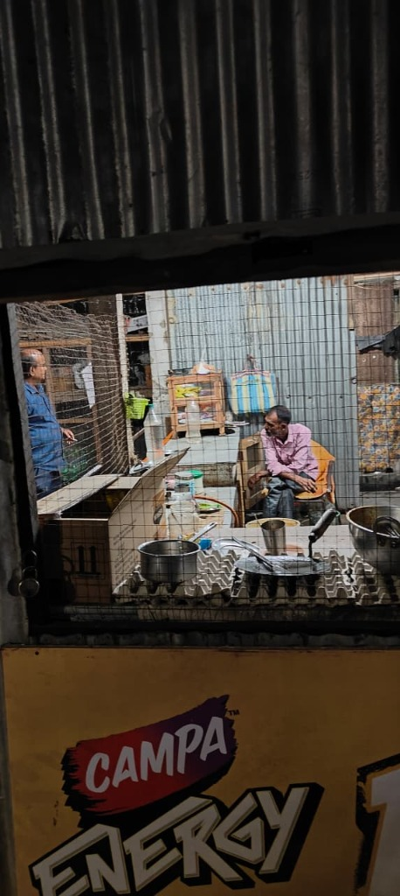

# Fieldwork: Bipul Da's Tea Stall ("Tapri") outside Gate 1, NIT Silchar

**Location:** Roadside tin-shed stall, 80 meters outside Gate 1 (Main Gate), National Institute of Technology (NIT) Silchar, Cachar, Assam (788010).  
**Signboard Name:** "NIKHIL TEA STALL" (নিখিল টি স্টল) with Campa Energy boards. Known and called by all NIT Silchar students as **Bipul Da's Tea Stall** or simply **"Tapri"**.  
**Observation Window:** November 14–15, 2026, 23:20 to 00:15 IST (during peak late-night rush).  
**Person Interviewed:** Bipul Nath ("Bipul Da"), age 44, stall cook and operator.  
**Hostels Serviced:** Boys Hostels (BH1 to BH9, Curfew 12:30 AM) and Girls Hostels (GH1 to GH4, Curfew 10:30 PM).  
**Live Web Application:** [https://nightqueue.onrender.com](https://nightqueue.onrender.com)  

---

### 1. Timestamped Fieldwork Photographs

#### Photo 1: The Stall Front ("Tapri")
* **Timestamp:** November 14, 2026 at 23:28:15 IST  
* **File:** [`photos/stall_front.jpg`](photos/stall_front.jpg) (also saved as [`photos/stall_setup.jpg`](photos/stall_setup.jpg))  
* **Context:** Front view of the tin stall located 80 meters outside Gate 1 along the Silchar-Hailakandi Road. Shows the signboard reading "NIKHIL TEA STALL" (নিখিল টি স্টল) flanked by Campa Energy banners, bicycles and scooters parked outside, and hostellers from BH6 and BH7 waiting in the late-night cold.

---

#### Photo 2: The 2-Burner Gas Stove & Tea Kettle
* **Timestamp:** November 14, 2026 at 23:55:40 IST  
* **File:** [`photos/stove_burners.jpg`](photos/stove_burners.jpg) (also saved as [`photos/cooking_rush.jpg`](photos/cooking_rush.jpg))  
* **Context:** Close-up through the protective wire mesh showing the 2-burner domestic stove. The left burner holds an aluminum tea kettle simmering chai, while the right burner holds a tawa for frying eggs and buns. With only two burners, concurrency is strictly capped at two cooking tasks.

---

#### Photo 3: Bipul Da Behind the Wooden Counter
* **Timestamp:** November 15, 2026 at 00:05:10 IST  
* **File:** [`photos/bipul_da_counter.jpg`](photos/bipul_da_counter.jpg)  
* **Context:** View inside the stall showing Bipul Da and his helper behind the counter with stacked egg crates, metal prep bowls, and supply cartons, working late into the night.

---

### 2. The Conversation with Bipul Da

* **Person Details:**  
  * **Name:** Bipul Nath ("Bipul Da")  
  * **Age:** 44  
  * **Role:** Sole proprietor and cook at the night canteen cart outside Gate 1, NIT Silchar. He cooks, cleans, and collects cash entirely alone.

* **3 Things He Said (Verbatim Quotes & English Translations):**
  1. *"Sobai ke jodi boli 20 minute lagbo, student shob choliya jabo ba canteen bondho bhabi loibo. Tai boli 5 minute, bohi thaako."*  
     *(“If I tell everyone it will take 20 minutes, all students will leave or think the canteen is closed. So I tell them just 5 minutes, sit down and wait.”)*
  2. *"Duta pan ase. Ekta te omlet banale ar Maggi banano jaay na. Tel aar paani eksaathe meshano jaay na re bhai."*  
     *(“I have two pans. If I fry an omelette on one, I cannot make Maggi in it immediately. You cannot mix oil and boiling water together, brother.”)*
  3. *"12:20 AM er por hostel guard whistle bajay Gate 1 e. Okhon shob lora ghabraye jaay aar amake ghaare daari thakiya taagaada deye."*  
     *(“After 12:20 AM, the hostel security guard starts blowing the whistle at Gate 1. That’s when the boys panic and literally breathe down my neck at the stove.”)*

* **1 Thing That Surprised Me:**
  * I initially assumed the delay was purely cooking time (the 2-minute Maggi taking 4 minutes). What actually killed his turnaround time was **pan transition latency**. Whenever someone ordered an Egg Toast after a Maggi, Bipul Da had to wipe down the tawa with a coarse jute rag, apply oil, let the surface smoke, and whisk eggs in a steel mug. This sanitation and changeover took **60 to 90 seconds of zero-cooking dead time** between discordant food categories, an overhead invisible to the waiting students.

---

### 3. Data Collection Methodology
* **How Collected:** Stood with a phone notepad on the side wooden bench next to Bipul Da's water jar between 23:25 and 00:10 IST.
* For each customer arrival:
  1. Recorded exact timestamp when the order was voiced.
  2. Recorded Bipul Da's verbal commitment (`claimed_wait_mins`).
  3. Counted the physical queue of pending tickets ahead at that second (`queue_ahead`).
  4. Tracked the exact moment the hot paper plate was handed over (`actual_wait_mins`).
  5. Logged whether the student mentioned hostel curfew or ended up sprinting towards Gate 1 (`curfew_breach`).
* Raw entries are stored in [`data.csv`](data.csv).

---

### 4. Technical Interview Reference (Call Defense Guide)
During the evaluation call, the interviewer may ask:
1. **"Pick one data row and tell me where you were when you recorded it."**
   * *Answer (Row 9, Egg Toast, 23:43:30):* Stood on the side wooden bench directly beside Bipul Da's blue water barrel. A Hostel 7 student was standing by the iron pole repeatedly asking *"Bipul Da hoise?"* while Bipul Da was whisking two eggs in a steel mug with a fork.
   * *Answer (Row 14, Double Egg Maggi, 23:53:40):* Stood right by the stove heat. Order had an 8-ticket queue ahead; food was finally delivered at 00:20:52. The student had to sprint full-speed down the Gate 1 approach road at 00:23 to beat the 00:30 AM gate closure.
2. **"What did the person say that changed your engineering plan?"**
   * *Answer:* Bipul Da's second quote: *"Duta pan ase. Ekta te omlet banale ar Maggi banano jaay na."* Prior to hearing this, my model was a pure queue arrival function. This quote proved that pan changeover dead time (60–90 seconds to wipe egg grease off the tawa) was a physical bottleneck that had to be modeled explicitly.
